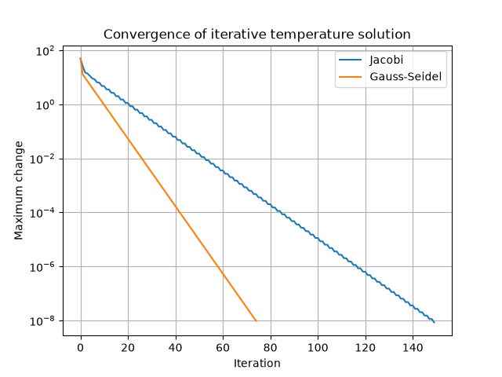
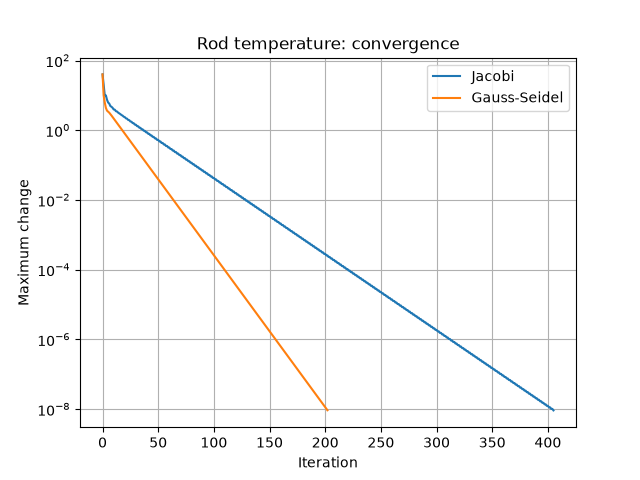

# Task 8: Iterative Methods for Linear Systems

## Inputs and operation
**Input:** a 5×5 matrix A (a heat-transfer grid, with 2 on the diagonal and -1 next to it) and a vector b = [100, 0, 0, 0, 20], where 100 °C is the left boundary temperature and 20 °C is the right one. The tolerance is 1e-8.

**Operation:** two iterative methods solve Ax = b, starting from a guess of all zeros.
- **Jacobi:** each new estimate of every unknown uses only the previous iteration's values.
- **Gauss-Seidel:** each unknown is updated using the newest values already computed in the same iteration.

After each iteration the program records the largest change in any unknown. It stops when that change is below the tolerance. The answer is compared with the direct solution from `np.linalg.solve`.

**Original output:**
```
Jacobi temperatures: [86.66666665 73.33333331 59.99999997 46.66666664 33.33333332]
Gauss-Seidel temperatures: [86.66666665 73.3333333  59.99999997 46.66666665 33.33333332]
Direct solution: [86.66666667 73.33333333 60.         46.66666667 33.33333333]
Jacobi iterations: 150
Gauss-Seidel iterations: 75
```

## Parameter change
**Change 1: tolerance from 1e-8 to 1e-3**
```
Jacobi temperatures: [86.66497153 73.33079063 59.99660973 46.66412396 33.3316382 ]
Gauss-Seidel temperatures: [86.66475179 73.33046102 59.99712769 46.66451243 33.33225622]
Direct solution: [86.66666667 73.33333333 60.         46.66666667 33.33333333]
Jacobi iterations: 70
Gauss-Seidel iterations: 35
```
A looser tolerance stops the methods earlier (70 and 35 iterations instead of 150 and 75), but the answers are less accurate: they are off by about 0.002 °C instead of about 0.00000002 °C. Tolerance trades speed against accuracy.

**Change 2: left boundary from 100 °C to 200 °C**
```
Jacobi temperatures: [169.99999998 139.99999997 109.99999996  79.99999997  49.99999998]
Gauss-Seidel temperatures: [169.99999998 139.99999997 109.99999997  79.99999998  49.99999999]
Direct solution: [170. 140. 110.  80.  50.]
Jacobi iterations: 154
Gauss-Seidel iterations: 77
```
Every temperature rose, and the profile is still a straight line from 200 °C down to 20 °C. The iteration counts hardly changed (154 and 77), so the speed of convergence depends mostly on the matrix A and not on the size of b.

## Meaning of the output
The five numbers are the steady temperatures at the five grid points between a hot end (100 °C) and a cooler end (20 °C). They fall in equal steps (86.7, 73.3, 60, 46.7, 33.3), which is what you expect from steady heat flow. Both methods agree with the direct solution to about 8 decimal places.

**Graph:** the vertical axis is the maximum change per iteration on a log scale, and the horizontal axis is the iteration number. Both lines are straight and fall steadily, which means the error shrinks by about the same factor each iteration. The Gauss-Seidel line is steeper than the Jacobi line, so it falls faster. It reaches the tolerance in 75 iterations, while Jacobi needs 150, which is about half. A line that falls steadily means the method converges; this works here because A is diagonally dominant.



## New case: temperature along a heated metal rod
**Assumptions:** a metal rod is heated to 80 °C at one end and held at 25 °C at the other. The temperature is found at 9 interior points along the rod in steady state. The tolerance is 1e-8. The code is in `code/Task_08_modified.py`.

**Output:**
```
Jacobi temperatures: [74.5 69.  63.5 58.  52.5 47.  41.5 36.  30.5]
Gauss-Seidel temperatures: [74.5 69.  63.5 58.  52.5 47.  41.5 36.  30.5]
Direct solution: [74.5 69.  63.5 58.  52.5 47.  41.5 36.  30.5]
Jacobi iterations: 406
Gauss-Seidel iterations: 203
```

**Parameter change:** the number of interior points was changed from 9 to 5.
```
Jacobi temperatures: [70.833 61.667 52.5   43.333 34.167]
Gauss-Seidel temperatures: [70.833 61.667 52.5   43.333 34.167]
Direct solution: [70.833 61.667 52.5   43.333 34.167]
Jacobi iterations: 148
Gauss-Seidel iterations: 75
```
With fewer points the iterations dropped from 406 to 148 (Jacobi) and from 203 to 75 (Gauss-Seidel). More grid points means a bigger system that converges more slowly.

**Interpretation:** the temperature falls in equal steps along the rod (5.5 °C per point with 9 points), from just under 80 °C to just over 25 °C. Gauss-Seidel again needs about half the iterations of Jacobi. For large systems, such as thousands of grid points in a heat model, iterative methods avoid the cost of factoring a huge matrix, but the iteration count grows with the size of the grid.

