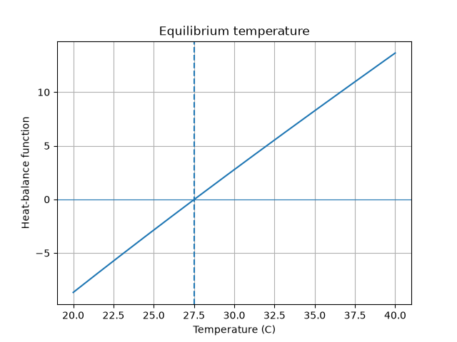
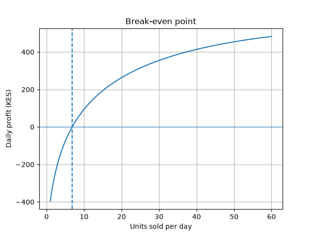

# Task 10: Root Finding: Bisection and Fixed-Point Methods

## Inputs and operation
**Input:** a heat-balance function f(T) = T − 25 − 10·e^(−T/20). The equilibrium temperature is the value of T where f(T) = 0. The bisection bracket is [20, 40], the tolerance is 1e-10, and the fixed-point method starts from T = 30.

**Operation:**
- **Bisection:** f(20) is negative and f(40) is positive, so a root lies between them. The method repeatedly halves the interval and keeps the half where the sign changes.
- **Fixed-point iteration:** the equation is rewritten as T = 25 + 10·e^(−T/20), and the program repeats T_new = g(T) until the change is below 1e-10.

**Original output:**
```
Bisection equilibrium temperature: 27.525211 C
Fixed-point equilibrium temperature: 27.525211 C
Fixed-point iterations: 13
Bisection iterations: 38
```



## Parameter change
**Change 1: bracket from [20, 40] to [20, 60] and tolerance from 1e-10 to 1e-3**
```
Bisection equilibrium temperature: 27.525024 C
Fixed-point equilibrium temperature: 27.525211 C
Fixed-point iterations: 13
Bisection iterations: 16
```
Bisection needed only 16 iterations instead of 38, because the looser tolerance stops it earlier, and the root is slightly less accurate (27.525024 instead of 27.525211). The wider bracket does not change where the root is. The fixed-point result is unchanged because those settings do not affect it.

**Change 2: fixed-point starting value from 30 to 60**
```
Bisection equilibrium temperature: 27.525211 C
Fixed-point equilibrium temperature: 27.525211 C
Fixed-point iterations: 14
Bisection iterations: 38
```
The answer is the same, and it took 14 iterations instead of 13. A start further from the root needs a little more work, but this g(T) converges from anywhere nearby.

**Change 3: the coefficient 10 changed to 30**
```
Bisection equilibrium temperature: 31.279175 C
Fixed-point equilibrium temperature: 31.279175 C
Fixed-point iterations: 22
Bisection iterations: 38
```
A larger coefficient moves the equilibrium from 27.53 °C to 31.28 °C, and fixed-point iteration takes longer (22 iterations). Bisection still takes 38, because it only depends on the bracket width and the tolerance.

## Meaning of the output
The equilibrium temperature is about 27.53 °C. At this temperature the heat gained equals the heat lost, so the temperature stops changing. Both methods find the same value to six decimals. Bisection is slow but certain, because it needs a sign change and always halves the interval (38 iterations). Fixed-point iteration was faster here (13 iterations), but it only works when g(T) is "flat" enough near the root, and it can fail for other equations.

**Graph:** the curve is the heat-balance function against temperature. It is negative below about 27.5 °C and positive above, and it crosses the zero line at the dashed vertical line, which marks the root. Where the curve crosses zero is the equilibrium. The curve rises steadily, so there is only one crossing in this range.

## New case: break-even point for a new product
**Assumptions:** a shop sells a new product. Daily profit is 300·ln(1 + q) − 2.5q − 600 KES, where q is the units sold per day. Revenue grows more slowly as customers saturate, cost grows linearly, and the fixed daily cost is 600 KES. These numbers are assumed. The break-even point is where profit = 0. The code is in `code/Task_10_modified.py`.

**Output:**
```
Bisection break-even: 6.8212 units per day
Fixed-point break-even: 6.8212 units per day
Bisection iterations: 37
Fixed-point iterations: 10
Profit at break-even: 0.00000000 KES
```



**Parameter change:** the fixed daily cost was raised from 600 to 900 KES, with the bracket widened to [1, 30].
```
Bisection break-even: 23.4128 units per day
Fixed-point break-even: 23.4128 units per day
Bisection iterations: 39
Fixed-point iterations: 18
Profit at break-even: -0.00000000 KES
```
A higher fixed cost means the shop must sell more before it makes a profit: the break-even rose from 6.8 to 23.4 units per day. (The `-0.00000000` is just rounding of a tiny negative number.)

**Interpretation:** the profit curve is below zero at low sales and crosses zero at about 6.8 units per day, so the shop needs to sell 7 units per day to start making a profit. After that, the profit keeps growing but more slowly, because revenue saturates. Both methods agree, and the profit at the root is zero. This is the same method as finding break-even points, interest rates or thresholds.