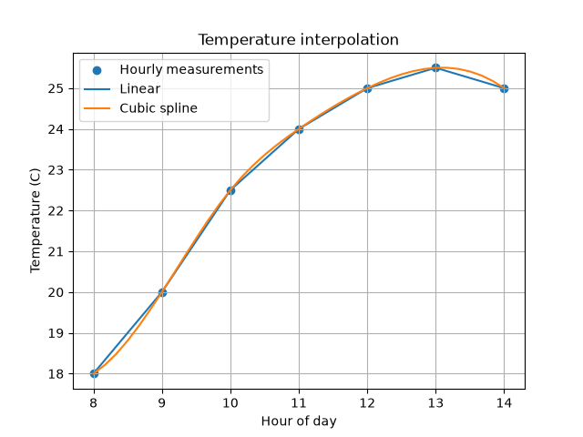
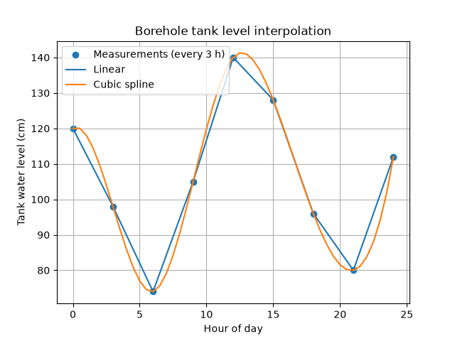

# Task 13: Interpolation

## Inputs and operation
**Input:** hourly temperatures from 08:00 to 14:00 (18.0, 20.0, 22.5, 24.0, 25.0, 25.5, 25.0 °C), and a request for estimates every 10 minutes.

**Operation:** two interpolation functions are built from the seven measurements.
- **Linear (`interp1d`):** joins neighbouring points with straight lines.
- **Cubic spline (`CubicSpline`):** joins them with smooth cubic curves.

Both are evaluated at every 10 minutes and at 10:30.

**Original output:**
```
Linear estimate at 10:30: 23.25 C
Cubic estimate at 10:30: 23.36 C
```



## Parameter change
**Change 1: the 11:00 reading changed from 24.0 to 30.0 °C**
```
Linear estimate at 10:30: 26.25 C
Cubic estimate at 10:30: 27.01 C
```
The linear estimate is exactly halfway between 22.5 and 30.0, which is 26.25. The cubic estimate is higher (27.01) because the smooth curve bends towards the large jump. When the data changes suddenly, the two methods disagree more.

**Change 2: the target time changed from 10:30 to 13:30**
```
Linear estimate at 13:30: 25.25 C
Cubic estimate at 13:30: 25.41 C
```
(The program's printed label still said 10:30, but the value is for 13:30.) Between 13:00 (25.5) and 14:00 (25.0) the linear estimate is 25.25, the midpoint. The cubic estimate is slightly higher (25.41) because the temperature levels off around that time.

## Meaning of the output
At 10:30 the linear method estimates 23.25 °C, exactly halfway between 22.5 and 24.0. The cubic method estimates 23.36 °C, a little higher, because the temperature was rising quickly and the curve bends as it levels off. The estimates are close, so either would do here.

**Graph:** the dots are the hourly measurements. The linear estimate is a set of straight segments with sharp corners at each measurement. The cubic spline is a smooth curve through the same dots. The curve rises quickly in the morning, then flattens near 25 °C after noon. Both pass through every measured point, and they differ most between the points.

## New case: water level in a borehole tank
**Assumptions:** the water level (cm) in a village tank is measured every 3 hours over a day. The level falls as people draw water and rises when the pump runs. The values are assumed. Estimates are made every 30 minutes. The code is in `code/Task_13_modified.py`.

**Output:**
```
Linear estimate at 10:30: 122.50 cm
Cubic estimate at 10:30: 126.54 cm
Lowest cubic estimate: 74.00 cm at hour 6.0
```



**Parameter change:** only every 6th reading was used (at hours 0, 6, 12, 18 and 24).
```
Linear estimate at 10:30: 123.50 cm
Cubic estimate at 10:30: 130.50 cm
Lowest cubic estimate: 61.09 cm at hour 4.0
```
With fewer measurements the two estimates move apart (123.5 against 130.5 cm). The cubic curve also dips to 61.09 cm at about 04:00, which is lower than any measurement. With only five points, the smooth curve overshoots, and the dip may not be real.

**Interpretation:** at 10:30 the tank is at about 122 to 127 cm, between the 09:00 reading (105 cm) and the 12:00 reading (140 cm), because the pump is filling it. The lowest level is about 74 cm at 06:00, when the most water is drawn. The cubic curve is smoother and fits a tank that changes gradually, but with sparse data it can overshoot, so the linear estimate is the safer one when readings are far apart.