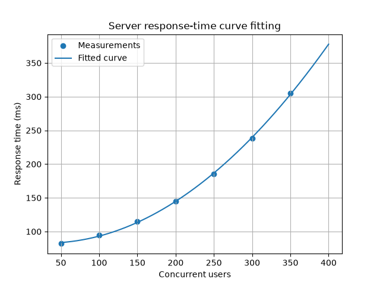
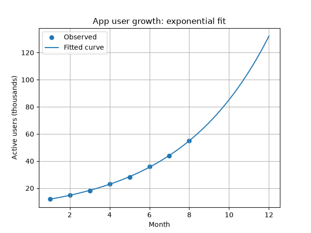

# Task 14: Curve Fitting and Approximation

## Inputs and operation
**Input:** server response times (82, 95, 115, 145, 185, 238, 305 ms) measured at 50 to 350 concurrent users.

**Operation:** the model is y = ax² + bx + c. `curve_fit` chooses a, b and c to minimise the sum of the squared differences between the model and the measurements (least squares). The program then calculates the RMSE (root mean squared error, the typical size of the misfit), predicts the response time for 400 users, and plots the data with the fitted curve.

**Original output:**
```
Fitted model: y = 0.002167x^2 + -0.1345x + 85.00
RMSE: 1.55 ms
Predicted response at 400 users: 377.86 ms
```



## Parameter change
**Change 1: a straight-line model fitted as well**
```
Linear fit RMSE: 18.83 ms
Fitted model: y = 0.002167x^2 + -0.1345x + 85.00
RMSE: 1.55 ms
Predicted response at 400 users: 377.86 ms
```
A straight line has an RMSE of 18.83 ms, while the quadratic has 1.55 ms. The line fits about 12 times worse, so the response time is not linear in the number of users: it rises faster as the load grows.

**Change 2: the last measurement changed from 305 to 450 ms**
```
Fitted model: y = 0.005619x^2 + -1.2048x + 147.14
RMSE: 28.05 ms
Predicted response at 400 users: 564.29 ms
```
One changed point made the curve steeper, and the RMSE rose from 1.55 to 28.05 ms because a quadratic cannot follow such a sudden jump. The prediction for 400 users rose from 378 to 564 ms. One unusual reading can change predictions a lot.

## Meaning of the output
The fitted curve says that the response time is about 85 ms with almost no load and grows faster and faster as users are added. The RMSE of 1.55 ms means the curve is typically within about 1.5 ms of the measured values, which is a very good fit. The model predicts about 378 ms at 400 users, but that is an extrapolation beyond the data (the highest measurement is at 350 users), so it is less certain.

**Graph:** the dots are the measurements and the line is the fitted curve. The curve passes very close to all seven points. It is almost flat at low load and bends upwards at high load. The part from 350 to 400 users is the prediction, where there are no measurements.

## New case: growth of a mobile-money app
**Assumptions:** an app has 12 to 55 thousand monthly active users over its first 8 months (assumed values). Growth looks exponential, so the model is users = a·e^(b·month). The code is in `code/Task_14_modified.py`.

**Output:**
```
Fitted model: users = 9.518 * exp(0.2192 * month)
RMSE: 0.31 thousand users
Monthly growth rate: 24.5%
Predicted users at month 12: 132.2 thousand
```



**Parameter change:** the month 8 value was changed from 55 to 85 thousand.
```
Fitted model: users = 5.433 * exp(0.3316 * month)
RMSE: 5.72 thousand users
Monthly growth rate: 39.3%
Predicted users at month 12: 290.4 thousand
```
One larger value raised the growth rate from 24.5% to 39.3% per month and the month 12 prediction from 132 to 290 thousand. The RMSE rose from 0.31 to 5.72, because the jump no longer follows a smooth curve.

**Interpretation:** the users grow by about 24.5% each month, and the model predicts about 132 thousand users in month 12. The fit is very close (RMSE 0.31 thousand). Exponential models can overestimate in the long run, because a market eventually saturates, so the prediction is only reliable for the near future. The change to the last value shows how strongly one data point can affect a forecast.