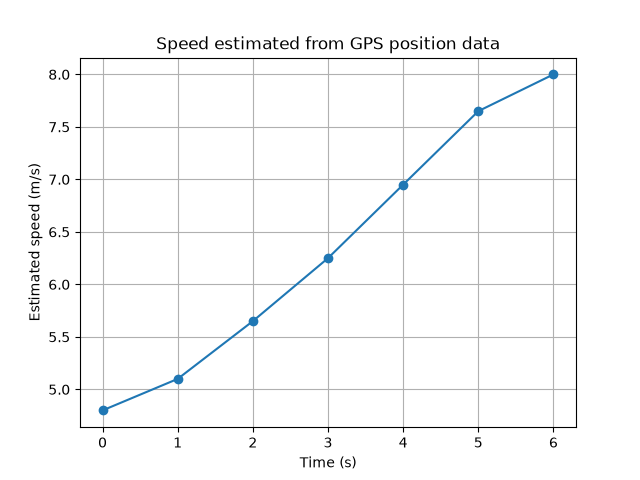
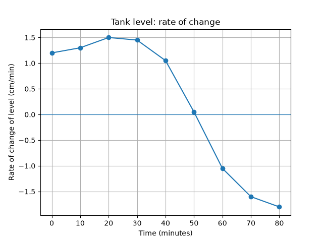

# Task 15: Numerical Differentiation

## Inputs and operation
**Input:** GPS positions in metres (0.0, 4.8, 10.2, 16.1, 22.7, 30.0, 38.0) at times 0 to 6 seconds, one reading per second.

**Operation:** speed is the derivative of position, estimated from differences.
- **Forward difference** at the first point: (x₁ − x₀) / Δt.
- **Central difference** at interior points: (xᵢ₊₁ − xᵢ₋₁) / (tᵢ₊₁ − tᵢ₋₁), which uses both neighbours.
- **Backward difference** at the last point: (x₆ − x₅) / Δt.

**Original output:**
```
t=0s, position=0.0m, estimated speed=4.80m/s
t=1s, position=4.8m, estimated speed=5.10m/s
t=2s, position=10.2m, estimated speed=5.65m/s
t=3s, position=16.1m, estimated speed=6.25m/s
t=4s, position=22.7m, estimated speed=6.95m/s
t=5s, position=30.0m, estimated speed=7.65m/s
t=6s, position=38.0m, estimated speed=8.00m/s
```



## Parameter change
**Change 1: the last position changed from 38.0 to 32.0 m**
```
t=0s, position=0.0m, estimated speed=4.80m/s
t=1s, position=4.8m, estimated speed=5.10m/s
t=2s, position=10.2m, estimated speed=5.65m/s
t=3s, position=16.1m, estimated speed=6.25m/s
t=4s, position=22.7m, estimated speed=6.95m/s
t=5s, position=30.0m, estimated speed=4.65m/s
t=6s, position=32.0m, estimated speed=2.00m/s
```
Only the speeds at t = 5 s and t = 6 s changed, because only they use the last position. The vehicle now seems to slow sharply, from 6.95 m/s to 2.00 m/s. The end points use one-sided differences, which are less accurate than central ones, so a single odd reading at the end has a big effect.

**Change 2: readings every 2 seconds instead of every second** (the positions are the same)
```
t=0s, position=0.0m, estimated speed=2.40m/s
t=2s, position=4.8m, estimated speed=2.55m/s
t=4s, position=10.2m, estimated speed=2.83m/s
t=6s, position=16.1m, estimated speed=3.12m/s
t=8s, position=22.7m, estimated speed=3.47m/s
t=10s, position=30.0m, estimated speed=3.83m/s
t=12s, position=38.0m, estimated speed=4.00m/s
```
The same distances now take twice as long, so every speed is half as large. This confirms that the speed estimate depends on the time interval as well as on the distance.

## Meaning of the output
The estimated speed rises from 4.8 m/s at the start to 8.0 m/s at the end, so the vehicle is steadily speeding up, by about 0.6 to 0.7 m/s every second. For example, at t = 3 s the central difference gives (22.7 − 10.2) / 2 = 6.25 m/s, which is an average speed over the surrounding two seconds. The central difference is usually more accurate than the forward or backward ones.

**Graph:** it shows estimated speed against time. The line rises steadily from about 4.8 to 8.0 m/s, which means constant-ish acceleration. The slope flattens slightly at the end, but that point uses a backward difference.

## New case: rate of change of a tank's water level
**Assumptions:** a tank's water level (cm) is measured every 10 minutes. A pump fills it, then a tap drains it. The readings are assumed values. `np.gradient` estimates the rate of change in cm per minute (central differences inside, one-sided at the ends). The code is in `code/Task_15_modified.py`.

**Output:**
```
t=0 min, level=40 cm, rate=+1.20 cm/min
t=10 min, level=52 cm, rate=+1.30 cm/min
t=20 min, level=66 cm, rate=+1.50 cm/min
t=30 min, level=82 cm, rate=+1.45 cm/min
t=40 min, level=95 cm, rate=+1.05 cm/min
t=50 min, level=103 cm, rate=+0.05 cm/min
t=60 min, level=96 cm, rate=-1.05 cm/min
t=70 min, level=82 cm, rate=-1.60 cm/min
t=80 min, level=64 cm, rate=-1.80 cm/min
Forward difference at t=20: +1.60 cm/min (central: +1.50 cm/min)
```



**Parameter change:** the last level was changed from 64 to 30 cm.
```
t=60 min, level=96 cm, rate=-1.05 cm/min
t=70 min, level=82 cm, rate=-3.30 cm/min
t=80 min, level=30 cm, rate=-5.20 cm/min
```
(The earlier rows are unchanged.) The drain rate at 70 and 80 minutes becomes much more negative (−3.30 and −5.20 cm/min instead of −1.60 and −1.80), as if the tap opened wide or there were a leak.

**Interpretation:** the level rises at a rate of about +1.2 to +1.5 cm/min while the pump is running, the rate falls to almost zero at 50 minutes (the tank is at its highest, 103 cm), and then it becomes negative as the tap drains the tank. The moment the rate crosses zero is when the level stops rising. At t = 20 the forward difference (+1.60) and the central difference (+1.50) differ slightly, which shows that the method chosen affects the estimate.

**Graph:** the line is positive and rises to about +1.5 cm/min near 20 minutes, falls through zero at about 50 minutes, and keeps falling to about −1.8 cm/min at 80 minutes.