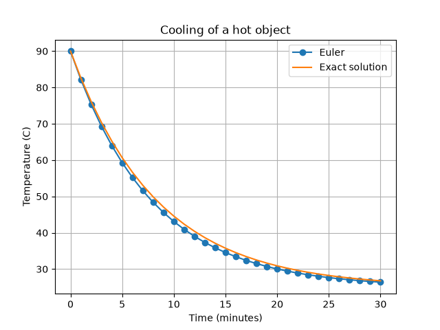
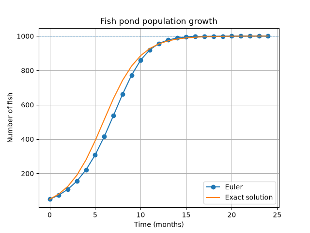

# Task 17: Ordinary Differential Equations: Euler Method

## Inputs and operation
**Input:** Newton's law of cooling, dT/dt = −k(T − T_ambient), with ambient temperature 25 °C, starting temperature 90 °C, k = 0.12 per minute, step size h = 1 minute and an end time of 30 minutes.

**Operation:** Euler's method starts from the known value and steps forward: T_new = T + h·f(T), where f(T) = −k(T − 25) is the cooling rate. The program also computes the exact solution, T = 25 + 65·e^(−0.12t), to check the answer.

**Original output:**
```
Euler temperature after 30 min: 26.40 C
Exact temperature after 30 min: 26.78 C
Final absolute error: 0.3720 C
```



## Parameter change
**Change 1: step size from 1 to 5 minutes**
```
Euler temperature after 30 min: 25.27 C
Exact temperature after 30 min: 26.78 C
Final absolute error: 1.5098 C
```
A bigger step gave a bigger error (0.37 to 1.51 °C). Each step multiplies the gap to the ambient temperature by 1 − kh = 0.4, but the true cooling over 5 minutes multiplies it by e^(−0.6) = 0.55, so Euler cools too fast.

**Change 2: k from 0.12 to 2.2 (step size back to 1)**
```
Euler temperature after 30 min: 15454.46 C
Exact temperature after 30 min: 25.00 C
Final absolute error: 15429.4604 C
```
The method became unstable. Each step now multiplies the gap by 1 − kh = −1.2. A factor with size above 1 makes the error grow and flip sign every step, so Euler gives an absurd 15,454 °C while the true answer is 25 °C. For this equation Euler is only stable when k·h < 2.

## Meaning of the output
The object cools quickly at first and then more slowly as it approaches the room temperature of 25 °C, because the cooling rate depends on the temperature difference. After 30 minutes the exact temperature is 26.78 °C, and Euler's estimate is 26.40 °C, an error of about 0.37 °C. A smaller step size gives a smaller error but needs more steps.

**Graph:** both curves start at 90 °C, drop steeply and flatten towards 25 °C. The Euler points lie slightly below the exact curve, because Euler uses the rate at the start of each step, where cooling is fastest, so it overestimates the cooling.

## New case: fish population in a pond
**Assumptions:** fish in a pond grow according to the logistic equation dP/dt = r·P·(1 − P/K), with growth rate r = 0.5 per month, capacity K = 1000 fish and 50 fish at the start. These are assumed values. The step size is 1 month, over 24 months. The code is in `code/Task_17_modified.py`.

**Output:**
```
Euler fish after 24 months: 1000.0
Exact fish after 24 months: 999.9
Largest error over the period: 99.2 fish
Month when Euler first exceeds 500 fish: 7
```



**Parameter change 1: step size from 1 to 3 months**
```
Euler fish after 24 months: 997.2
Exact fish after 24 months: 999.9
Largest error over the period: 241.5 fish
Month when Euler first exceeds 500 fish: 9
```
**Parameter change 2: step size from 1 to 0.25 months**
```
Euler fish after 24 months: 999.9
Exact fish after 24 months: 999.9
Largest error over the period: 25.8 fish
Month when Euler first exceeds 500 fish: 6
```
The largest error grew from 99.2 to 241.5 fish with a bigger step and fell to 25.8 fish with a smaller one. The final value is close to 1000 in every case, but the timing of the growth is where the error shows up.

**Interpretation:** the population grows slowly at first, fastest around month 6 and then levels off at the pond capacity of 1000. Euler's method lags behind the exact curve during the fast-growth phase and catches up near the limit. With a 1-month step the largest error is about 99 fish, and a smaller step makes the estimate much more accurate. If a farmer wants to know when the pond will be half full, the step size changes the answer by months (month 9 with h = 3 against month 6 with h = 0.25).