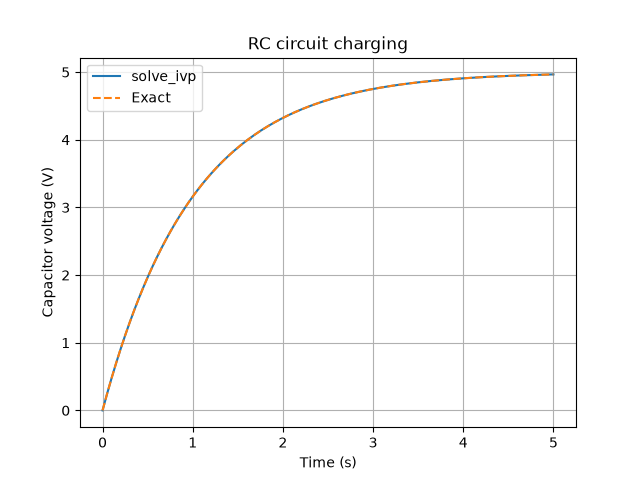
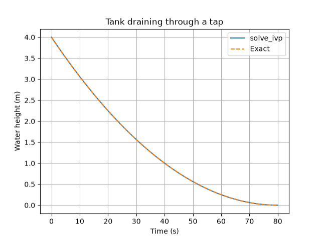

# Task 18: Numerical Solution of ODEs Using SciPy

## Inputs and operation
**Input:** an RC charging circuit with supply voltage Vs = 5 V, resistance R = 1000 Ω, capacitance C = 0.001 F and an initial capacitor voltage of 0 V. It is solved from 0 to 5 seconds.

**Operation:** the circuit obeys dV/dt = (Vs − V)/(RC). `solve_ivp` solves this numerically. It uses higher-order steps and chooses its own step sizes, with tolerances rtol = 1e-9 and atol = 1e-11. The result is compared with the exact curve V = Vs(1 − e^(−t/RC)).

**Original output:**
```
Solver success: True
Capacitor voltage at 5 s: 4.9663 V
Maximum error against exact solution: 9.282e-10 V
```



## Parameter change
**Change 1: resistance from 1000 to 3000 Ω**
```
Solver success: True
Capacitor voltage at 5 s: 4.0556 V
Maximum error against exact solution: 4.847e-10 V
```
The time constant RC rose from 1 s to 3 s, so the capacitor charges more slowly. After 5 s it has reached only 4.0556 V (about 81% of 5 V) instead of 99.3%.

**Change 2: supply voltage from 5 V to 12 V**
```
Solver success: True
Capacitor voltage at 5 s: 11.9191 V
Maximum error against exact solution: 2.269e-09 V
```
The speed of charging is unchanged (still RC = 1 s), so after 5 s the capacitor again reaches 99.3% of the supply, now 11.9191 V. The supply voltage sets the final value but not how fast it is reached.

## Meaning of the output
The capacitor voltage rises from 0 V towards the supply voltage of 5 V. After 5 s (five time constants, since RC = 1 s) it has reached 4.9663 V, which is 99.3% of the supply. The maximum error compared with the exact formula is about 1e-9 V, so the numerical solution is essentially exact.

**Graph:** the curve rises steeply at the start and then flattens as it approaches 5 V. The numerical solution (solid) and the exact curve (dashed) lie on top of each other, so the dashed line is hard to see. This is the typical shape of charging: the voltage changes fastest when the difference from the supply is largest.

## New case: a water tank draining through a tap
**Assumptions:** a tank starts with 4 m of water and drains through a tap according to Torricelli's law, dh/dt = −k·√h, with k = 0.05. These are assumed values. The solver stops when the tank is empty, using an event. The exact empty time is 2√h0/k = 80 s. The code is in `code/Task_18_modified.py`.

**Output:**
```
Solver success: True
Tank empty at (solver): 79.96 s
Tank empty at (exact):  80.00 s
Height after 20 s: 2.250 m
Maximum error against exact solution: 4.306e-10 m
```



**Parameter change:** k was doubled from 0.05 to 0.10.
```
Solver success: True
Tank empty at (solver): 39.98 s
Tank empty at (exact):  40.00 s
Height after 20 s: 1.000 m
Maximum error against exact solution: 4.197e-10 m
```
Doubling the outflow constant halves the time to empty (80 s to 40 s), and after 20 s the tank holds only 1.000 m instead of 2.250 m.

**Interpretation:** the tank empties in about 80 seconds. The solver's value (79.96 s) is 0.04 s earlier than the exact one (80.00 s) because the event stops when the height reaches 0.000001 m, not exactly zero. The error against the exact solution is only about 4e-10 m. **Graph:** the water height falls quickly at first and then more slowly as the tank empties, because the flow depends on the height (the √h term), and it reaches zero at 80 s.