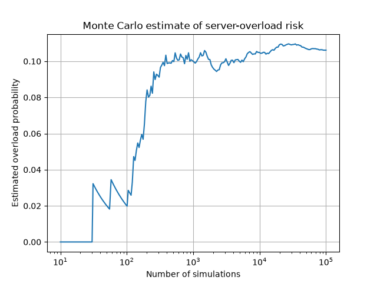
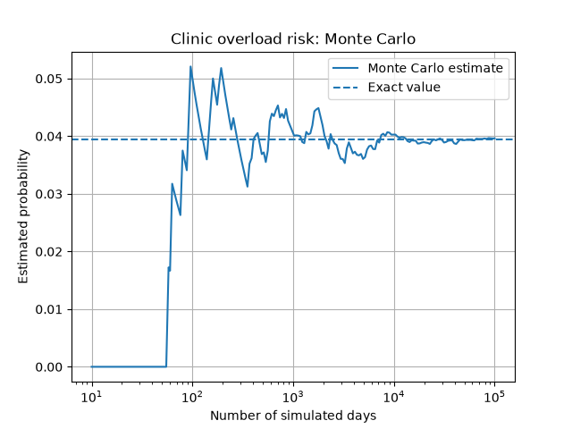

# Task 20: Random Numbers and Monte Carlo Methods

## Inputs and operation
**Input:** a server with capacity 1000 and random demand that follows a normal distribution with mean 850 and standard deviation 120. The program simulates N = 100,000 scenarios. A fixed seed (42) makes the random numbers repeat in every run.

**Operation:** the program generates random demand values, marks every scenario where demand is above 1000 as an overload, and estimates the overload probability as overloaded scenarios divided by total scenarios. It also records the running estimate to show how it converges as the number of simulations grows.

**Original output:**
```
Estimated overload probability: 10.6160%
Number of overload cases: 10616 out of 100000
```



## Parameter change
**Change 1: simulations from 100,000 to 1,000**
```
Estimated overload probability: 10.1000%
Number of overload cases: 101 out of 1000
```
With only 1,000 simulations the estimate is 10.1%, further from the theoretical value of about 10.56% than the 100,000-run estimate (10.62%). Fewer simulations means a noisier estimate.

**Change 2: capacity from 1000 to 950**
```
Estimated overload probability: 20.2210%
Number of overload cases: 20221 out of 100000
```
Lowering the capacity makes overloads more common: about 1 day in 5 instead of about 1 in 10.

**Change 3: standard deviation of the demand from 120 to 200**
```
Estimated overload probability: 22.6020%
Number of overload cases: 22602 out of 100000
```
The average demand is the same, but a wider spread means more extreme demand values, so the overload probability more than doubled (10.6% to 22.6%).

## Meaning of the output
In about 10.6% of the simulated scenarios the demand exceeds the capacity of 1000, so the server is overloaded roughly 1 time in 10. The average demand is 850, below the capacity, but the random variation sometimes pushes it above. The estimate agrees with the theoretical probability for this normal distribution (about 10.56%).

**Graph:** it shows the running estimate against the number of simulations on a log scale. For the first 30 or so simulations the estimate is 0%, because no overloads have happened yet. It then jumps to about 3% and bounces around, climbs to about 10% by a few hundred simulations, wobbles between roughly 9.5% and 11%, and settles near 10.6% by 100,000 simulations. This is the main idea of Monte Carlo methods: the more random samples, the closer the estimate gets to the true probability.

## New case: how often a clinic is overwhelmed
**Assumptions:** a clinic can treat 60 patients a day. The number of patients per day is random, following a Poisson distribution with a mean of 48. These numbers are assumed. The program simulates 100,000 days and compares the result with the exact Poisson probability. The code is in `code/Task_20_modified.py`.

**Output:**
```
Estimated overwhelmed probability: 3.9620%
Exact probability: 3.9500%
Overwhelmed days: 3962 out of 100000
Expected overwhelmed days per year: 14.5
```



**Parameter change:** the mean number of patients was raised from 48 to 55.
```
Estimated overwhelmed probability: 22.5700%
Exact probability: 22.6054%
Overwhelmed days: 22570 out of 100000
Expected overwhelmed days per year: 82.4
```
With a higher average demand the clinic is overwhelmed on about 82 days a year instead of about 15.

**Interpretation:** with a mean of 48 patients, the clinic exceeds its capacity of 60 on about 4% of days, around 14 to 15 days a year. The Monte Carlo estimate (3.962%) is very close to the exact value (3.950%), which validates the method. **Graph:** the estimate swings between 0% and about 5% in the first few hundred days, then settles onto the dashed exact line by roughly 10,000 simulations. A rise of only 7 patients in the average demand increases the overload frequency more than fivefold, so a manager would plan extra staff on busy days.